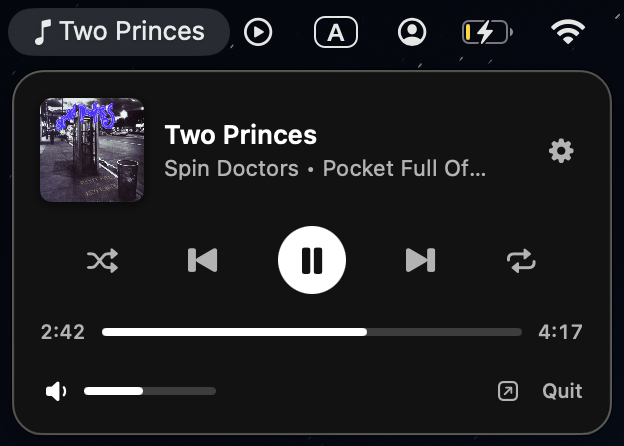

# Statify

A tiny Spotify controller for the macOS menu bar.



## Requirements

- macOS 13 or later
- The Spotify desktop app

## Install

Download the latest release, or build from source.

## Build

```sh
make app      # builds build/Statify.app
make run      # builds and launches it
```

On first launch macOS asks for permission to control Spotify. Approve it in
**System Settings → Privacy & Security → Automation**.

## License

MIT
